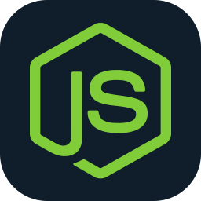
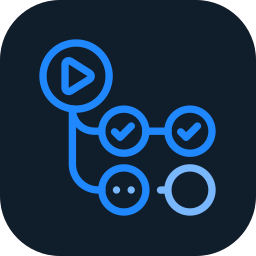

  

  <strong>I build game systems, developer tools, and the automation that ships them.</strong>

  <a href="https://github.com/alexaa1212ss?tab=repositories">Explore my repositories</a>
  &nbsp; · &nbsp;
  <a href="https://github.com/alexaa1212ss/game">Cavegame Reborn</a>
  &nbsp; · &nbsp;
  <a href="https://github.com/alexaa1212ss/game/blob/main/docs/ENGINEERING.md">Engineering notes</a>

  Explore the sections below ↓

---

<h3>👋 About me</h3>

I'm a software developer interested in how interactive software works from the protocol layer through the player experience.

My toolkit spans web development, systems languages, runtime tooling, and automation across Windows, Linux, and iOS. I enjoy connecting the layers: understanding a protocol, building a usable client, and making the release process repeatable.

**Current focus:** Cavegame Reborn — game systems, Windows player delivery, and verified updates.

<h3>🧰 Languages &amp; tools</h3>

#### Languages

  
  
  
  
  
  
  

JavaScript · HTML · CSS · C · C++ · Rust · Go

#### Runtime & automation

  
  
  
  

Node.js · PowerShell · GitHub Actions · GitHub

#### Platforms

  
  
  

Windows · Linux · iOS

**Also in my project toolkit:** WiX installer tooling · WebSocket · JSON · Ed25519 signatures · SHA256 verification

<h3>⛏️ Featured project — Cavegame Reborn</h3>

A Windows game player and release pipeline that brings together binary protocol tooling, player identity, verified updates, and installer automation.

| Part of the project | What it does |
| :--- | :--- |
| Binary protocol | Schema-driven JavaScript encoding and decoding, bounded buffers, and cached writers. |
| Windows player delivery | A per-user MSI generated with Node.js and WiX. |
| Update integrity | Ed25519 release signatures and SHA256 verification of files and archives. |
| Release automation | Native launcher, player login, protocol movement, update, and identity persistence checks. |

[Explore the repository →](https://github.com/alexaa1212ss/game) &nbsp; [Read the engineering overview →](https://github.com/alexaa1212ss/game/blob/main/docs/ENGINEERING.md) &nbsp; [Latest release →](https://github.com/alexaa1212ss/game/releases/latest)

Cavegame Reborn is an evolving alpha. The repository documents hosting, signing, and verification limitations alongside the implementation.

<h3>⚙️ Build notes &amp; how I work</h3>

#### Understand the system

Follow the data, read the implementation, and make assumptions explicit. I like working through how protocols, runtimes, and user-facing behavior fit together.

#### Build for the user

Make installation, recovery, and everyday use understandable. A feature includes the path people take to install it and keep using it.

#### Verify the behavior

Automate meaningful checks, preserve useful diagnostics, and document what still needs hands-on verification.

**Code to explore:**

- [Binary protocol codec](https://github.com/alexaa1212ss/game/blob/main/build/protocol-codec.mjs)
- [Windows installer generator](https://github.com/alexaa1212ss/game/blob/main/build/make-player-installer.mjs)
- [Installed-player acceptance checks](https://github.com/alexaa1212ss/game/blob/main/build/ci-player-acceptance.mjs)
- [Windows release pipeline](https://github.com/alexaa1212ss/game/blob/main/.github/workflows/player-release.yml)

---

  <a href="https://github.com/alexaa1212ss"><strong>Find my work on GitHub →</strong></a>

  Explore · Build · Refine &nbsp; | &nbsp; Icons by <a href="https://github.com/tandpfun/skill-icons">Skill Icons</a>

