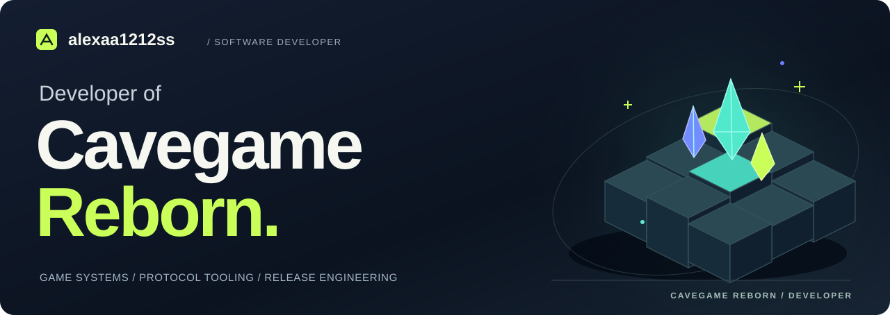
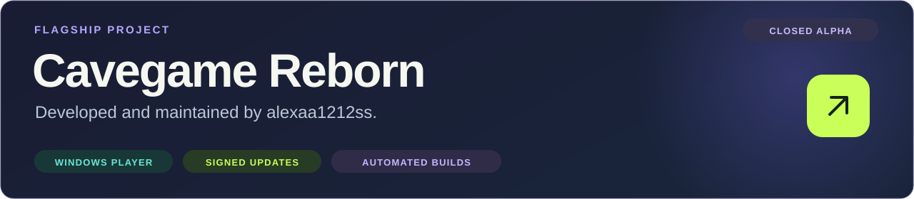
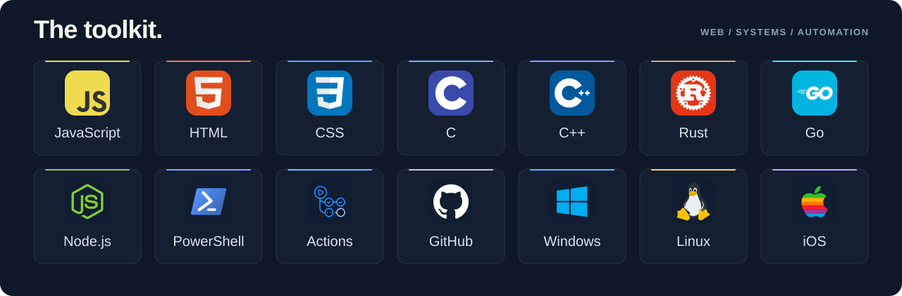

  

  
  
  

I'm **alexaa1212ss**, the developer of **Cavegame Reborn**. I work on game systems and the tooling around them: network protocols, Windows installers, and automated releases.

 

<strong>Inside Cavegame Reborn</strong>

| System | Implementation |
| :--- | :--- |
| [Binary protocol](https://github.com/alexaa1212ss/game/blob/main/build/protocol-codec.mjs) | Schema-driven JavaScript codec with typed fields, bounded buffers, and cached writers. |
| [Windows installer](https://github.com/alexaa1212ss/game/blob/main/build/make-player-installer.mjs) | Node.js and WiX tooling for a per-user MSI and bundled player runtime. |
| [Release pipeline](https://github.com/alexaa1212ss/game/blob/main/.github/workflows/player-release.yml) | Build, installation, update, and uninstall checks before stable channel promotion. |
| [Player verification](https://github.com/alexaa1212ss/game/blob/main/build/ci-player-acceptance.mjs) | Native launcher startup, login, protocol movement, and identity persistence checks. |
| Update integrity | Ed25519 release signatures and SHA256 verification of files and archives. |

[Engineering overview](https://github.com/alexaa1212ss/game/blob/main/docs/ENGINEERING.md) · [Release notes](https://github.com/alexaa1212ss/game/blob/main/ALPHA-NOTES.md)

 

<strong>Full toolkit</strong>

| Area | Technologies |
| :--- | :--- |
| Web | JavaScript, HTML, CSS |
| Systems | C, C++, Rust, Go |
| Runtime & automation | Node.js, PowerShell, GitHub Actions |
| Platforms | Windows, Linux, iOS |
| Project tooling | WiX, WebSocket, JSON, Ed25519, SHA256 |

<strong>About the developer</strong>

My current work centers on **Cavegame Reborn**: the player experience, the systems behind it, and the tools used to deliver updates.

I work across JavaScript and systems languages, with an interest in game networking, runtime behavior, and desktop tooling. The public repository contains player distribution files, protocol tooling, and release automation.

[Browse my repositories](https://github.com/alexaa1212ss?tab=repositories)

 

<!-- Technology logos: Skill Icons by tandpfun. See THIRD_PARTY_NOTICES.md. -->
